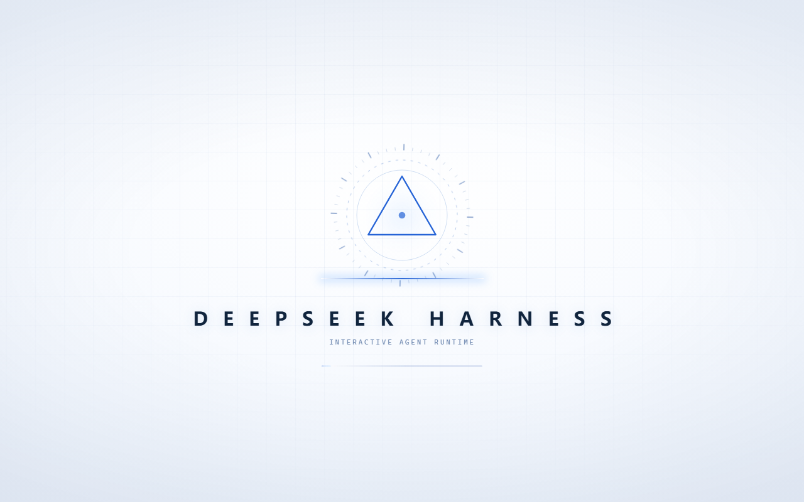

# DSH-desktop-boot-animation

DSH Desktop / DSH Web 的开机动画：**8 秒浅色序列 + 开机音**。以 Cordis 客户端插件形式
装入 `desktop` profile，不改 DSH 源码，不替换任何可执行文件。



## 安装

两种方式安装的是同一份插件，`client/client.js` 已含内嵌音频，均无构建步骤。

### 方式一：Release 压缩包

从 [Releases](https://github.com/TapKeen/DSH-desktop-boot-animation/releases/latest) 下载
`dsh-startup-animation-1.2.0.tgz`：

```powershell
dsh plugin add "$HOME\Downloads\dsh-startup-animation-1.2.0.tgz"
```

### 方式二：克隆仓库

```powershell
git clone https://github.com/TapKeen/DSH-desktop-boot-animation.git "$HOME\DSH-desktop-boot-animation"
dsh plugin add "$HOME\DSH-desktop-boot-animation"
```

装完**完整退出并重启 DSH Desktop**。profile 组合每个 Host generation 只计算一次，
运行中的实例看不到新插件。

## 使用

| 操作 | 键 |
|---|---|
| 跳过 | 任意键 / 点击 / `Esc` |
| 静音切换 | `M` |

静音偏好持久化在 `localStorage['dsa:sound']`。系统启用「减少动态效果」时退化为静态画面
（1.1 秒）。每个窗口会话只播放一次。

## 序列

| 时间 | 画面 |
|---|---|
| 0.0–1.0s | 舞台升起 |
| 0.4–2.4s | 三角徽章描边绘制 |
| 0.6s | 扫描线开始，3 秒一轮 |
| 0.8–2.3s | `DEEPSEEK HARNESS` 逐字浮现 |
| 2.1s | 副标题，显示 `window.__DSH_BOOT__` 中的外壳版本号 |
| 2.4–7.7s | 进度条填充 |
| 3.2s | 跳过提示 |
| 5.4–7.8s | 两圈确认脉冲 |
| 8.0s | 淡出 |

音频从 0 秒起全程铺底。

## 架构

**插件形态** —— 标准 Cordis 客户端插件，通过 `dsh.bundle.patch` 插入 profile 的
layer stack。宿主扫描 Loader 条目、组合启动图，把 `exports["./client"]` 经 `/plugins`
发给浏览器。

**两半** —— `lib/index.js`（主机半侧）为空实现，不注册路由、服务、配置或定时器。
`client/client.js`（浏览器半侧）承载全部功能。

**Bundle 格式** —— 手写的 `window.__ModuleLoader__.load({ id, factory })`，不经打包器。
DSH 不对该产物做解析、转译或类型检查。因此文件内不能出现 JSX 或 TypeScript。
`dsh.client.inject` 为空，不 require React 或任何 `@deepseek-ai/*` 包。

**挂载位置** —— 覆盖层挂到 `document.body`，`z-index` 为 `2147483647`。
`shell.overlay` 容器是 `position: absolute; z-index: 20`，会创建层叠上下文，
子元素的 `z-index` 无法超出该层级，无法承载全屏覆盖层。

**音频** —— 由使用者提供，base64 内嵌于 `client/client.js`。主机半侧不提供 HTTP 路由，
浏览器没有可拉取音频文件的 URL。原始素材同时保存在 `assets/boot-chime.mp3`。

**音频链路** —— `BufferSource → 片段增益 → 低通 16 kHz → 压缩器 → 主增益 → destination`。

**收尾** —— 所有声音在 7.65 秒前归零，AudioContext 在静音后才关闭（跳过时 320ms，
自然结束时 700ms）。素材长于播放窗口时自动淡出，短于窗口时由其自身收尾。
起始有 20ms 淡入，消除第 0 个采样点的直流跳变。

**时序常量** —— 分镜集中在 `client/client.js` 的 `T` 对象，进度条填充时长由总时长反推：

```js
const BAR_FILL_MS = SEQUENCE_MS - T.barInDelay - T.barFillPad;
```

**配色** —— 集中在 `P` 对象。浅色主题：深色下的加色发光、亮蓝强调与暗角在白底上不可用，
改用淡蓝晕、饱和深蓝 `#2563d6` 与极浅边缘压暗。

## 替换开机音

```powershell
$env:ELECTRON_RUN_AS_NODE = '1'
& "DSH Desktop.exe" scripts/embed-audio.mjs . "你的音频.mp3"
```

脚本校验容器类型（MP3 / WAV / Ogg）、做 base64 往返比对，并生成
`client/client.js.pre-embed` 备份。该备份已列入 `.gitignore` 与 `package.json` 的
`files` 白名单，不会进入发布包。

素材建议 1–8 秒。WAV 是裸 PCM，可直接裁剪；MP3 难以做帧精确裁剪。

## 配置

| 位置 | 常量 | 默认值 |
|---|---|---|
| `client/client.js` | `SEQUENCE_MS` | `8000` |
| | `REDUCED_MS` | `1100` |
| | `VOLUME` | `0.85` |
| | `AUDIO_END_MS` | `7650` |
| | `AUDIO_START_MS` | `0` |
| | `P` / `T` | 配色与分镜 |

## 排查

浏览器开发者工具中：

```js
__dshStartupAnimation.play()               // 强制重放
__dshStartupAnimation.play({ silent: true })  // 重放，本次静音
__dshStartupAnimation.audioError           // 最后一次音频失败的原因
__dshStartupAnimation.soundActive          // 音频上下文是否建立
__dshStartupAnimation.sound(false)         // 关闭声音并持久化
__dshStartupAnimation.timeline             // 分镜常量
```

音频不可用时动画静音播放，原因同时输出到控制台。

## 卸载

```powershell
dsh plugin remove dsh-startup-animation
```

或保留安装、临时禁用，向 `%USERPROFILE%\.dsh\profiles\desktop\cordis.patch.yml` 追加：

```yaml
- id: startup-animation
  name: dsh-startup-animation
  disabled: true
```

## 已知限制

- 仅覆盖 `platform: "web"` 的客户端半侧，不涉及终端 TUI。
- 在 DSH `0.2.0-rc.2` 上验证。宿主升级后需要重新确认客户端 bundle 契约。
- 开机音的权利归提供者所有，不在 MIT 授权范围内。

## 致谢

视觉语汇参考 [Ar1haraNaN7mI/deepseek-harness-rust-optimize](https://github.com/Ar1haraNaN7mI/deepseek-harness-rust-optimize)
的启动动画：三角形为主体的徽章、刻度环、平面扫描线。该项目的
`integrations/native-startup/` 是宿主侧 Cordis 插件的实现参考。

本仓库的代码、CSS、SVG 均独立编写，未使用该项目的代码、图形、字体或音频。

浏览器插件契约（`dsh.client`、`window.__ModuleLoader__`、平台种子模块表）来自
DeepSeek 官方 DSH。

## 许可

MIT，见 [LICENSE](LICENSE)。
